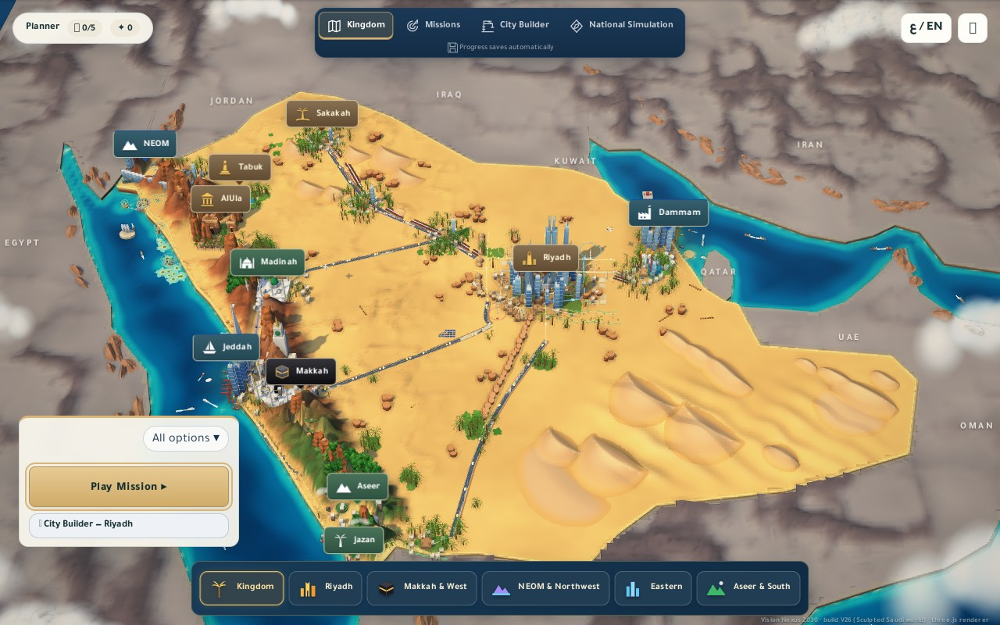
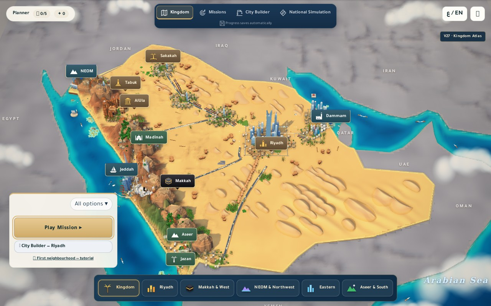
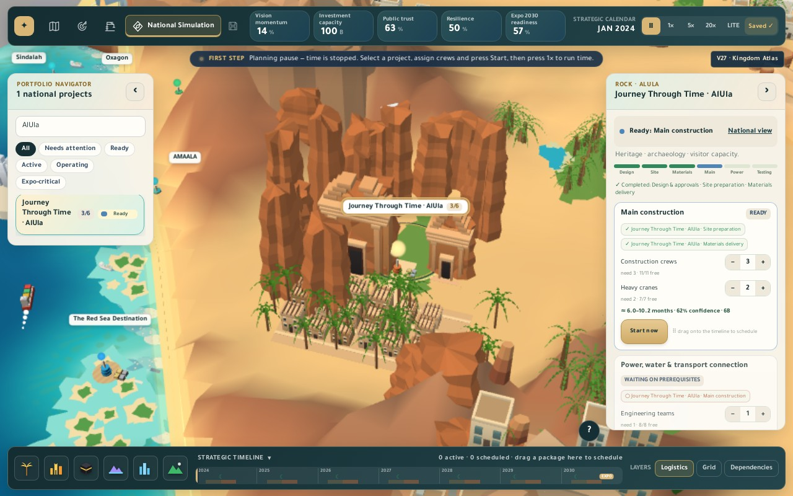

# V27 — country-first art and reliable launching

This is the complete project on top of V26 (`6d46b757b96f84f23c7da11bbd2230a38f65b4d9`), including all earlier City Builder assets and gameplay. The focus is the country view, followed by making the existing AlUla scene reliably discoverable.

## Start the correct copy

Extract the ZIP and open the folder containing `package.json` and `Launch_Prototype.bat`. Close the previous game server window with Ctrl+C, then double-click `Launch_Prototype.bat`, or run `npm start` and open **http://127.0.0.1:8123**. Look for **V27 · Kingdom Atlas** near the top corner. No npm install is required to play.

The previous Windows launcher opened the address after a fixed delay even if its new server had failed to bind. An old server on port 8123 could therefore keep showing the old game. The new Node and Python launchers open the browser only after successful startup, or after verifying that the identical folder and build are already running. An old/different server is reported visibly and is never silently opened or killed. The port stays unchanged to preserve browser saves.

The AlUla map badge and National Simulation project navigator now share one camera framing. The project panel continues to show its real construction stage and controls.

## National art changes

- Planned courtyard-house districts around eleven existing cities, with parapets, recessed roofs, facade windows, regional materials, gardens and local streets. Western houses use projecting window screens; southern tower houses use pale stone bands.
- Three composed ports with quays, piers, containers, warehouse roofs and cranes. Boat-route validation now includes these new harbor footprints as well as land and islands.
- Broader western terrain, irregular layered ridge meshes, smaller supporting outcrops and planted southern terraces. Ridge height respects the simulation's protected road/project clearances.
- More sculpted dune fields across the north, central desert and southeast. A conservative clearance cache reduces repeated startup work while keeping dunes away from protected footprints.
- The compact menu retains its Tutorial entry; the longer gameplay checks caught that it had been hidden by the earlier compact-menu styling.
- Smaller palms, a brighter turquoise/blue sea, a stronger gold outline and quieter neighboring land. The distant water/backdrop continues beyond the phone frame; a narrow source-polygon seam is sealed visually.
- A continuous tapered Kingdom Centre mesh with an open crown. National labels move away from prominent silhouettes and can find another nearby position when they would overlap.
- Instanced national cars and trains follow the displayed smoothed roads and rails. Multi-part ships are merged into one mesh per vessel. Superseded legacy static scenery is hidden in the national main/depth passes; live stage, mission and city layers, and picking, remain active.

All new geometry is authored procedurally for this repository. No reference image is used as scenery, no paid generation was used, and no new external asset license or download is required. Existing third-party notices remain in `vendor/`.

## Actual gameplay comparison

Both versions use Chrome 131 headless shell, 1280 × 800, High quality, fixed daytime and frozen decorative motion. The default V27 camera is slightly wider and more elevated to keep the southern edge visible. The two `kingdom-matched.jpg` images use the **identical V26 camera position**.

[Interactive comparison gallery](review.html)

Before — V26 national view:

After — V27 national view:

AlUla selected through the actual National Simulation project list:

## Verification

Verification results and measured rendering timings are recorded in `validation.json`, `before/results.json` and `after/results.json`. The source data, regional plans, project identifiers, simulation/economy code, controls, save schemas and storage keys are unchanged.

Run `npm test`, `npm run test:launcher`, `npm run test:atlas`, `npm run test:render`, `npm run test:cinematic` and `npm run test:tutorial`. Development tests need Playwright Core and Chrome/Edge; launch does not. `npm run check:atlas` captures the current project. Baseline capture additionally needs the V26 Git commit available locally.

## Remaining limitations

The art is stylized procedural 3D, with substantially less fine modeling and surface texture than the supplied painted reference. This pass develops the national composition; regional planning close-ups still use their earlier assets apart from AlUla. The geography remains the game's existing illustrative layout. Existing-world landmarks are decorative orientation scenery; they do not mark simulated projects complete.

Performance measurements use CPU-based SwiftShader, not a physical GPU, with 18 recorded frames after six warm-up frames. They are short diagnostics, not a hardware FPS claim. The Windows batch file is reviewed but was not executed on Windows; the Node/Python startup, busy-port and reuse behaviors are exercised as real processes on Linux. Phone checks use a browser viewport, not a physical phone.

### Recorded checks and timings

305 logic/save assertions; three launcher test groups; eight renderer checks; eight cinematic browser checks plus geometry checks; 12 City Builder consequence checks; and eight final Atlas/navigation checks passed. The full tutorial run passed 44 of 45 checks and found the hidden menu Tutorial link. That isolated CSS regression was fixed and its exact visibility check passed in the final Atlas run; the entire tutorial script was not rerun after that correction. No browser errors or missing assets were reported by the final capture.

| Tier | V26 mean / p95 frame ms | V27 mean / p95 frame ms | Main-pass calls | Main-pass triangles |
|---|---:|---:|---:|---:|
| high | 578.7 / 1158.5 | 442.2 / 861.4 | 169 → 107 | 740,200 → 537,272 |
| low | 322.8 / 712.3 | 197.9 / 837.7 | 169 → 107 | 582,555 → 381,900 |

The final headless run reached the home menu in 10.8 seconds. Timings use each version's default national framing and include software-rendering overhead; draw/triangle counts cover the main pass only, not shadow/post-processing passes. The identical-camera images are for visual comparison.
