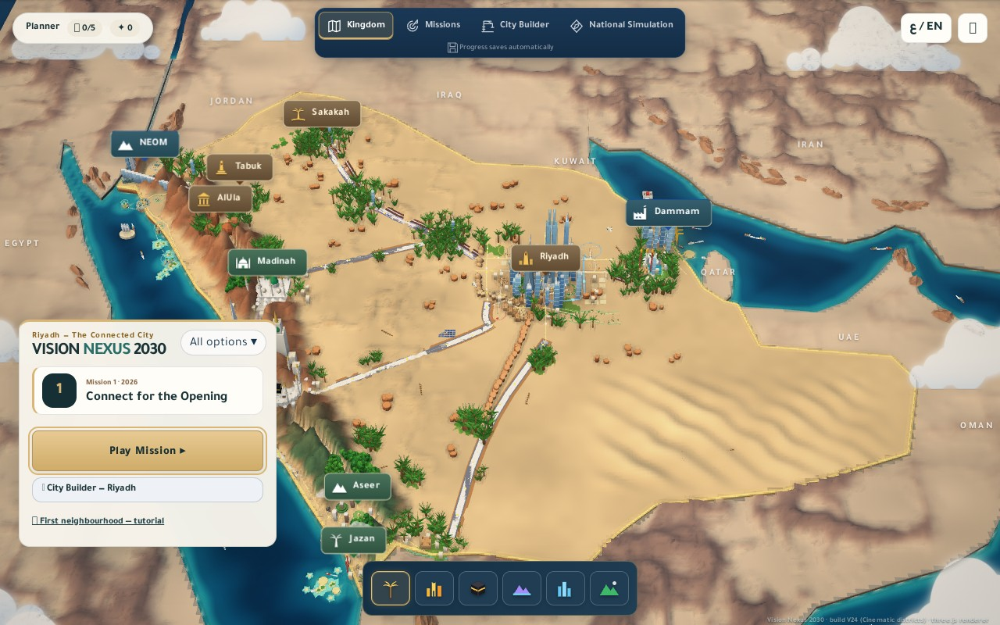
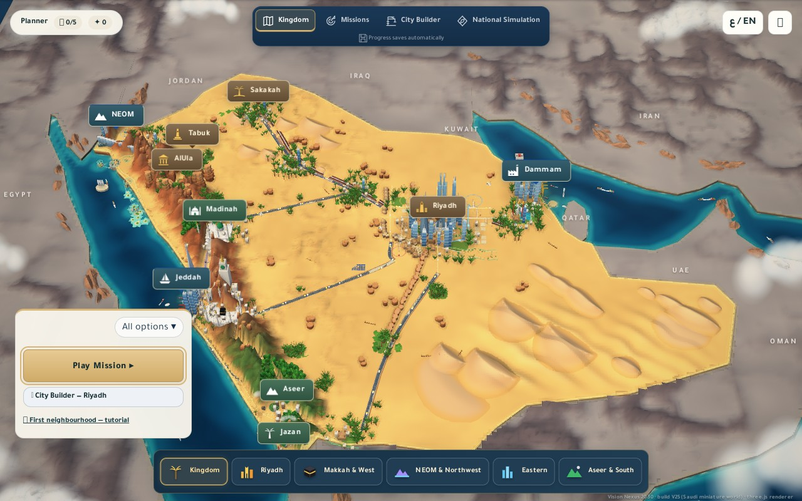
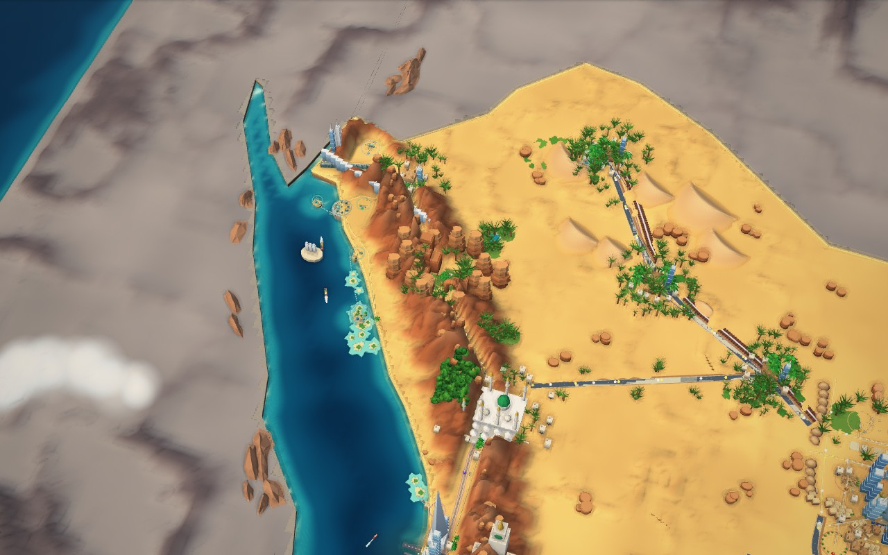

# V25 — Saudi miniature world

## Scope and launch

This is a complete cumulative update on top of V24 (`8e4731817c69ae61349e264dce02e438220fe737`). It keeps the existing browser/Three.js stack and the original simulation, IDs, controls, translations and save schemas. There is no engine migration or build step. All runtime assets are included in the repository; no CDN or paid asset service is required.

Extract the download and enter the folder containing **package.json**. On Windows, double-click **Launch_Prototype.bat**, or run **npm start** and open **http://127.0.0.1:8123**. A GitHub ZIP can be inside another similarly named folder: use the inner folder containing the package file. Keep the same browser and address to retain local saves. Ctrl+F5 reloads updated code; the corner badge should say **V25 (Saudi miniature world)**. For macOS/Linux use `./launch.sh` or `npm start`. Do not open the HTML directly if you want the Three.js treatment.

## Five gaps found and addressed

1. **Missing dune geometry:** national dune fields were configured but the group list was empty. The established seeded dune generator is now called with land/road/project clearance. Ten accepted groups produce real asymmetric ridges and crescents, with separate High and Reduced meshes.
2. **Weak mountain silhouettes:** western ridges now have stronger stratification and 52 irregular rock buttresses. Southern rock groups include planted terrace shelves. These are merged geometry, not a background illustration.
3. **Generic settlement detail and scale:** shared settlement blocks gain windows, entrances and roof equipment; AlUla gains a stepped portal, columns, irregular sandstone formations and an arch with a real opening. Smaller palms and slightly shorter exaggerated skylines improve relative scale. Highland villages sample ground height at their actual displayed coordinates, fixing multiplied terrain elevation.
4. **Competing surroundings and scenery:** warmer golden land, reddish rock and regional greenery contrast with cooler, quieter neighbours. Narrower asphalt roads no longer dominate as white ribbons. Cloud textures have soft radial edges. Boats use validated water circuits with hull margins and island checks; unsafe seeds stay moored. Instanced palm crowns move gently, respecting reduced-motion preferences.
5. **Map obscured by menus:** a compact launcher keeps mission and City Builder entry points accessible, with the full mission/progression/settings menu under **All options**. All six regional buttons show text and fit on a phone, including Arabic RTL. Portrait national framing has 30% extra camera distance to keep the country edges visible; the desktop camera is unchanged.

The northwest/AlUla area was rendered first. Inspection prompted a second pass on rock shapes, road widths, cloud edges and menu footprint before the final national captures. The reference's pixels are never used as the playable world.

## Existing gameplay retained

City Builder still places roads/zones/services on the same grid, checks occupied parcels and utility constraints, grows buildings from simulation events and displays actual power, coverage and transport results. The V24 update included in this branch supplies the detailed courtyard houses, shopfronts, service buildings, gardens, traffic, responsive placement feedback and sound controls. Regional/national project construction continues to use the existing stage/progress data. Decorative national city silhouettes are illustrative orientation landmarks, not a claim that every project is completed.

No save version or localStorage namespace changed. Old campaign, City Builder and National Simulation saves continue through the existing loaders. Navigation and scenery do not spend resources or alter progression. Existing collision rules are grid/placement and route rules; this game has no walking character physics system.

## Geography and art sources

The game data's projection, national polygon, city/project IDs and regional plans remain authoritative. The supplied image is compositional guidance, not a geographic map. The existing geography tests check the northeast/east/west/south relationships, non-overlapping plans, land/sea placement and road/landmark clearance.

The northwest sandstone/heritage treatment was checked against the [Royal Commission for AlUla's description](https://www.rcu.gov.sa/en/about-rcu/about-alula). Coastal and southwestern context was checked against the [Saudi Red Sea Authority](https://www.redsea.gov.sa/en). These sources support regional identity; they are not surveyed terrain data. Buildings are intentionally enlarged for national-map readability; concept developments are illustrative, and no official architectural accuracy is claimed. All added assets are original procedural geometry/textures; see [asset credits](../../ASSETS_CREDITS.md).

## Verification and performance

See [validation.json](validation.json) for the final test results and the measured table below. The comparison script uses the same 1280 × 800 viewport, High quality, frozen decorative time and camera for V24 and V25. `kingdom-ui.jpg` includes the real interface; `kingdom.jpg` and `northwest.jpg` hide DOM overlays only. [Open the gallery](review.html).

Reproduce with `npm test`, `npm run test:reference`, `npm run test:render`, `npm run test:cinematic`, and `npm run test:tutorial`. Browser tests need `npm install` and Chrome/Edge, or `CHROME_PATH` pointing to a compatible installed browser. `node tools/check-reference.js before` reads the V24 baseline with `git show` and therefore requires the repository's Git history; `npm run check:reference` captures the current version. Launching/playing requires no development dependencies.

National rocks/buildings share merged meshes; foliage uses instancing. Distant neighbour terrain has fewer samples, low quality halves palm instances and reduces terrain/dune tessellation, and night-colour updates use a cached material set rather than traversing the entire scene each frame. National terrain uses baked directional shading and soft contact decals; the close regional renderer retains its existing real-time shadows/material effects.

The available test host uses **Chrome headless shell 131.0.6778.204 with ANGLE/SwiftShader software rendering**, not a physical GPU. Timing runs sample 18 frames after six warm-up frames at each tier. They are short diagnostic samples, not a hardware benchmark or an FPS guarantee. The previous V24 premium suite's phone performance threshold failed on this host (263.7 ms/frame versus <50 ms); this update does not claim that hardware-performance acceptance has been met. A real desktop/mobile GPU pass remains necessary.

The result is a stylized browser miniature, not the reference image's painted level of detail or Unreal photorealism. No surveyed terrain, photogrammetry or physical-phone testing is included. The national silhouettes and detailed regional scenes retain the game's existing scale transition.

### Measured national view (software renderer only)

| Tier | V24 mean / p95 ms | V25 mean / p95 ms | V24 → V25 triangles | Draw calls |
|---|---:|---:|---:|---:|
| High | 474.5 / 922.1 | 453.2 / 545.9 | 732,876 → 704,416 | 170 → 170 |
| Low | 297.1 / 855.3 | 289.0 / 569.4 | 549,184 → 558,741 | 170 → 170 |

High geometry is reduced by about 3.9%; Reduced geometry increases about 1.7% because the previously missing dunes are now present. Mean timings are slightly lower in this run, but these short CPU-rendered samples do not establish a statistically reliable speedup. Both tiers remain below an interactive frame rate on this software-rendered host.

## Captured comparison

Before (V24):

After (V25):

Northwest / AlUla after the representative-region iteration:

