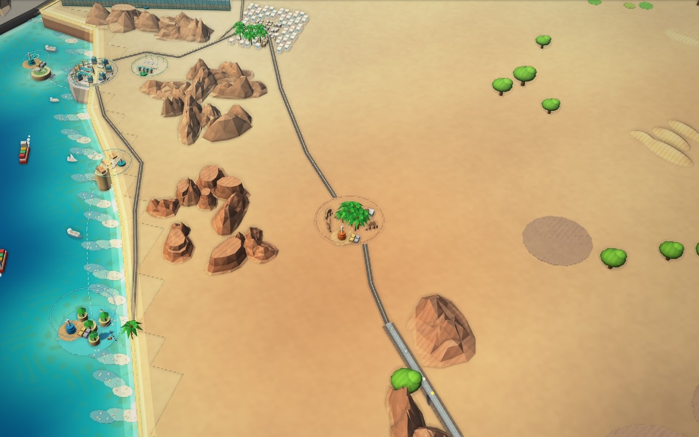
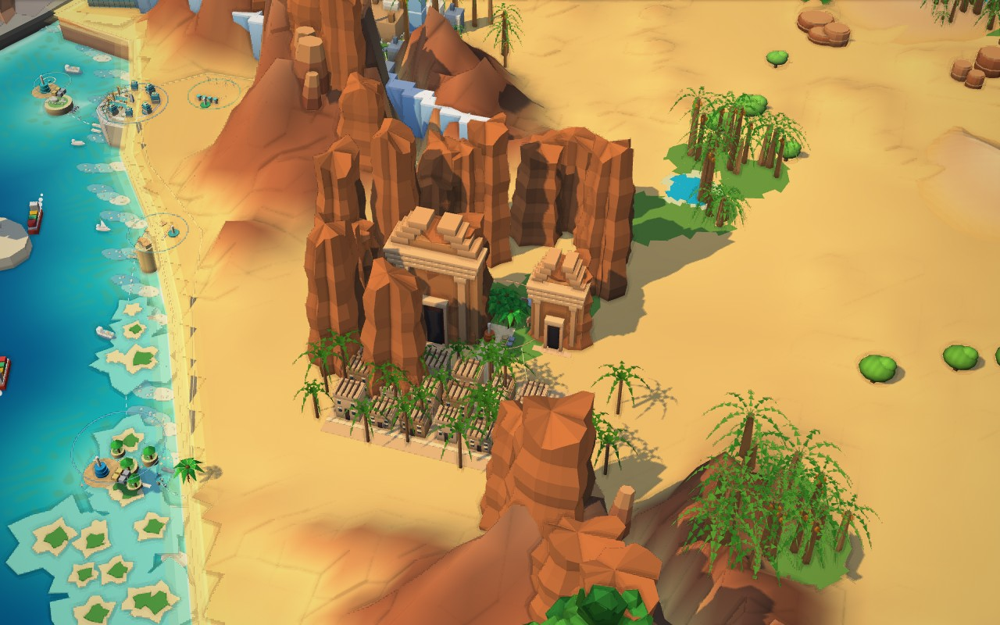

# V26 — northwest art rebuild

This cumulative runnable branch builds on V25 (`c17bb60566bb0cbbcc7c1eb6d13f72616bfee7da`). The scope is a representative AlUla/northwest rebuild plus shared lighting, foliage and water improvements. It is **not** a claim that the whole game now matches the supplied illustration.

## Play and inspect

Extract the complete ZIP, enter the folder containing `package.json`, then double-click **Launch_Prototype.bat** or run `npm start`. Open **http://127.0.0.1:8123**. The corner badge should read **V26 (Sculpted Saudi world)**. Use the same browser/address for existing saves; Ctrl+F5 reloads the new scripts.

Click **AlUla** on the national map to fly into the new 3D heritage scene. Pan, orbit and zoom with the existing controls. The six region buttons remain available; **Kingdom** returns to the national view. AlUla's label also supports keyboard Enter/Space. The original Northwest regional planning view and its project systems remain available through the regional navigation.

## What changed

- Original mesh kit in `sculpted-world.js`: asymmetric eroded sandstone formations with fissures and strata, two carved portal facades with columns/cornices/stepped crowns, 18 parapet houses with windows, doors and roof beams, paved village lanes, and 26 local palms.
- A cleared heritage valley keeps houses and entrances above ground. This corrects a problem identified in the first close-up render, where older terrain buried the village.
- The national overview now participates in the existing sun-depth pass and receives filtered shadows. Earlier versions excluded the entire overview from that pass. Decorative transparent layers stay out of the depth pass; material and LOD visibility are restored afterwards, including after picking.
- Thin curved ribbon fronds replace the overview's spiky cone leaves. Duplicate legacy palms are suppressed when the overview scenery is active; the new heritage forecourt has its own planting composition.
- More turquoise shallows and blue mid-depth water, compact map labels and a quieter navy navigation frame.
- AlUla inspection retains the same geometry while zooming closer, instead of switching it off at the old national-view distance threshold.

The regional plans, project IDs, simulation code, prices, progression, control bindings, save schemas and storage keys are unchanged. This branch includes all earlier V24/V25 City Builder features and assets. The added landmark architecture is decorative orientation scenery; it does not falsely mark simulated projects complete.

## Visual iteration

The first close-up exposed covered village plots, oversized old palms and incorrect cliff-cap winding. The follow-up pass cleared the valley, reduced planting conflicts, corrected the cap triangles and created readable lanes/entrances. Screenshots below are browser renders, not concept images or a flat replacement map.

Before — V25, same close-up camera:

After — V26, same close-up camera:

National view:

## Validation and limits

See `validation.json` and `before/results.json` / `after/results.json` for exact checks and measurements. Run `npm test`, `npm run test:sculpted`, and `npm run test:render`. Tests require the development dependencies plus Chrome/Edge (or `CHROME_PATH`); playing does not. `npm run check:sculpted` captures the current version. Baseline captures use `git show` and need the Git history.

Rendering tests use Chrome 131 headless shell with SwiftShader software rendering at 1280×800. Timing samples contain 18 measured frames after six warm-up frames and are diagnostic only. There is no physical-GPU or phone benchmark. Adding real shadow casting has a rendering cost; Reduced disables that sampling. Hardware FPS is unverified, and the earlier software-phone performance failure has not been claimed fixed.

The northwest is still stylized low-poly geometry rather than the reference's painted detail. Other regional skylines remain the previous assets. The coast and national road layouts remain the existing illustrative geography. This pass establishes inspectable geometry and real lighting; it does not finish a full kingdom-wide environment-art rebuild.

### Recorded checks

305 logic/save assertions, seven sculpted-scene/navigation/phone checks and eight render checks across Three.js/classic passed. Capture runs reported no browser errors or missing assets.

| Tier | V25 mean / p95 ms | V26 mean / p95 ms | Main-pass triangles, V25 → V26 |
|---|---:|---:|---:|
| high | 550.7 / 1072.8 | 601.6 / 1304.4 | 704,416 → 740,200 |
| low | 376.4 / 808.2 | 372.1 / 1302.1 | 558,741 → 582,555 |
